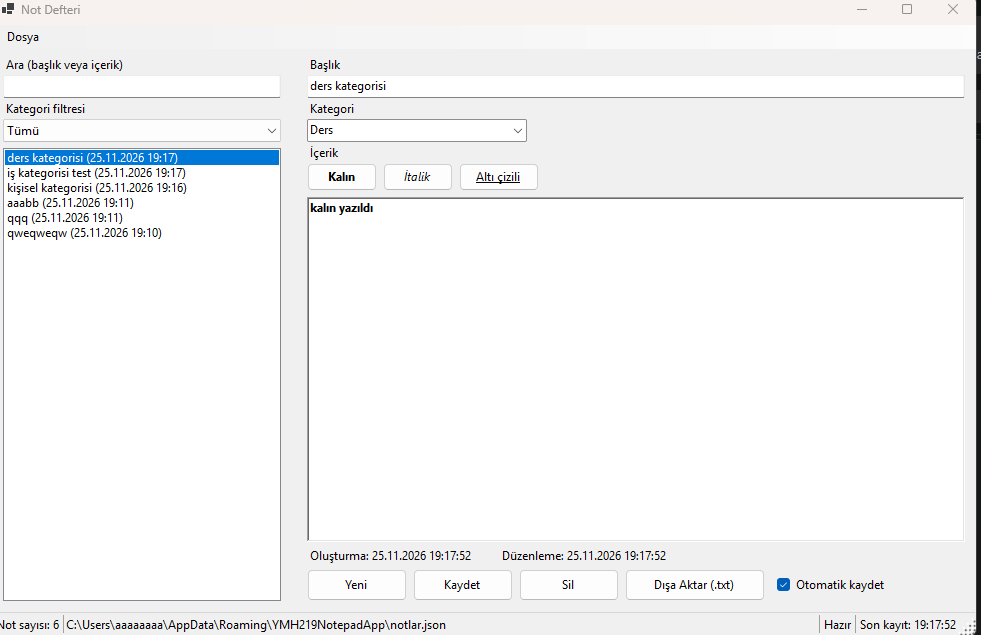
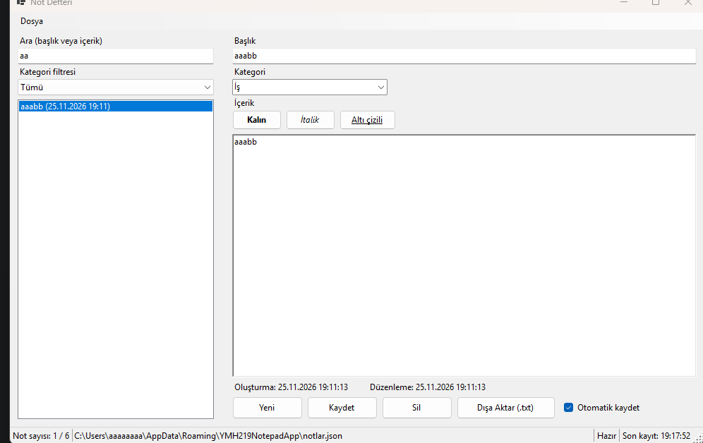

# YMH219-NotepadApp (Not Defteri)

Başlık, kategori ve içerikten oluşan notların eklenip düzenlendiği, JSON dosyasında saklandığı ve `.txt` olarak dışa aktarılabildiği C# Windows Forms uygulaması. YMH 219 Nesne Tabanlı Programlama dersi ek uygulama ödevidir.

## Kullanılan teknolojiler

- C# / .NET 10 (`net10.0-windows`), Windows Forms
- `System.Text.Json` (JSON serileştirme) ve `System.IO` (`File`, `StreamReader`, `StreamWriter`), ikisi de .NET ile gelir
- Harici NuGet paketi kullanılmamıştır

## Kurulum ve çalıştırma

Gereksinim: .NET 10 SDK; tasarımcı için Visual Studio 2026 veya dotnet run

```
git clone https://github.com/mah0cb/YMH219-NotepadApp.git
cd YMH219-NotepadApp
```

**dotnet run ile:**

```
dotnet run --project NotepadApp
```

**Visual Studio ile:** `YMH219-NotepadApp.sln` dosyasını açın ve F5'e basın.

## Temel özellikler

- Not ekleme, listeleme, düzenleme ve onaylı silme
- Notların JSON dosyasına kaydedilmesi ve açılışta otomatik yüklenmesi
- Oluşturma ve düzenleme tarihlerinin tutulması
- Seçili notu `.txt` olarak dışa aktarma
- Başlık ve içerikte Türkçe uyumlu arama, kategori desteği ve kategori filtresi
- Kalın, italik ve altı çizili metin biçimlendirme
- İsteğe bağlı otomatik kaydetme
- Kaydedilmemiş değişiklik uyarısı
- Kısayollar: Ctrl+N (yeni not), Ctrl+S (kaydet)

### Veri dosyası ve hata yönetimi

Notlar `%AppData%\YMH219NotepadApp\notlar.json` dosyasında saklanır.

| Durum | Davranış |
|---|---|
| Dosya yok | Boş liste ile başlanır, durum çubuğunda bilgi verilir |
| JSON bozuk | Dosya `notlar.bozuk-<tarih>.json` adıyla yedeklenir, kullanıcı uyarılır, boş liste ile devam edilir |
| Dosya okunamıyor | Hata gösterilir; eski notlar ezilmesin diye başarılı bir yüklemeye kadar kaydetme kapatılır |
| Dosya yazılamıyor | Hata gösterilir, değişiklikler bellekte kalır |
| Yazma yarıda kalır | Önce `.tmp` dosyasına yazıldığı için eski dosya korunur |

### Proje yapısı

| Dosya | Görev |
|---|---|
| `Models/Not.cs` | Not sınıfı |
| `Services/NotYoneticisi.cs` | `List<Not>` yönetimi, arama, `NotlarDegisti` olayı |
| `Services/INotDeposu.cs` | Depolama arayüzü |
| `Services/JsonNotDeposu.cs` | JSON okuma/yazma |
| `Services/YuklemeSonucu.cs`, `Services/NotDeposuException.cs` | Yükleme sonucu ve depolama hatası |
| `Services/TxtDisaAktarici.cs` | `.txt` dışa aktarma |
| `Services/MetinBicimleyici.cs` | Metin biçimlendirme |
| `Forms/AnaForm.cs` | Arayüz ve olay bağlama |

## Ekran görüntüleri

**Ana ekran: not listesi ve biçimlendirilmiş not**



**Arama ve kategori filtresi**



## Bilinen sınırlamalar / geliştirme notları

- "Otomatik kaydet" yazarken değil; ekleme, güncelleme, silme, not değiştirme ve kapatma sırasında çalışır. Seçim uygulama kapanınca hatırlanmaz.
- `.txt` dosyasına biçimlendirme aktarılmaz, yalnızca düz metin yazılır.
- Biçimlendirme karakter karakter uygulandığı için binlerce karakterlik seçimlerde kısa bir bekleme olabilir.
- Uygulama aynı anda iki kez açılırsa son kaydeden, diğerinin değişikliklerinin üzerine yazar.
- Notlar şifrelenmeden saklanır.

## Öğrenci

Mahmut Başcı, 205542016
